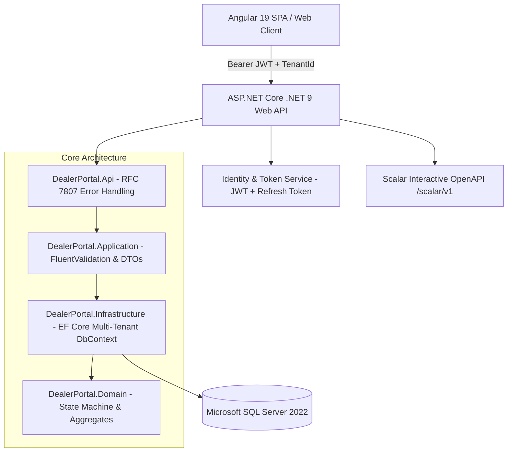

# B2B Bayi Sipariş & Stok Yönetim Portalı (Enterprise Multi-Tenant Portal)

Bu proje; kurumsal distribütör ve bayi ağları için tasarlanmış, **Domain-Driven Design (DDD)** ve **Clean Architecture** prensiplerine dayalı, çok kiracılı (**Multi-Tenant**) B2B Bayi Sipariş, Fatura ve Stok Yönetim Portalıdır.

Modern .NET 9 mimarisi ile Angular 19 (Signals tabanlı durum yönetimi) ve PrimeNG bileşen ekosistemini bir araya getirerek yüksek performanslı, denetlenebilir ve ölçeklenebilir bir kurumsal çözüm sunar.

---

## 🏛️ Mimari Yapı & Tasarım Prensipleri



### 1. Domain-Driven Design (DDD) & Kapsüllenmiş Durum Makinesi

- **Sipariş Yaşam Döngüsü (`Order` Aggregate Root):**
  Durum geçişleri doğrudan entity içerisinde kapsüllenmiştir:
  $$\text{Draft} \xrightarrow{\text{Submit}} \text{Submitted} \xrightarrow{\text{Approve}} \text{Approved} \rightarrow \text{Invoiced}$$
  $$\text{Submitted} \xrightarrow{\text{Reject}} \text{Rejected}$$
- **Kredi Limiti Kontrolü:** Sipariş onaya gönderilirken (`Submit`), bayinin mevcut cari borcu ve açık sipariş tutarı toplamının kredi limitini aşıp aşmadığı Domain katmanında denetlenir.
- **Atomik Fatura & Stok Hareketi:** Sipariş onaylandığında (`Approve`), aynı veritabanı transaction'ı içerisinde:
    1. Ürün stoğu düşülür (`DeductStock`)
    2. Sipariş faturalandırılır (`Invoice` ve `InvoiceLine`)
    3. Stok hareket kaydı atılır (`StockMovement` audit kaydı)
    4. Bayinin cari borcu sipariş tutarı kadar artırılır.

### 2. Çok Kiracılı Mimari (Multi-Tenancy)

- **Shared Database, Isolated Schemas (Tenant Discriminator):** Tüm veriler tek bir yüksek performanslı veritabanında tutulur; ancak kiracılar arasındaki izolasyon EF Core Global Query Filter (`ITenantEntity`) ile otomatik olarak sağlanır.
- **TenantSaveChangesInterceptor:** `SaveChanges` esnasında araya girerek yeni eklenen tüm varlıklara geçerli oturumun `TenantId` değerini basar ve çapraz kiracı veri sızıntılarını engeller.

### 3. İyimser Eşzamanlılık (Optimistic Concurrency)

- `Product` ve kritik entitiler üzerinde `RowVersion (byte[])` tanımlıdır. İki kullanıcının aynı anda son stoğu sipariş etmeye çalışması durumunda `DbUpdateConcurrencyException` yakalanır ve RFC 7807 standart Problem Details formatında `409 Conflict` olarak istemciye iletilir.

### 4. Güvenlik & Yetkilendirme

- **JWT + Kriptografik Refresh Token:** Kısa ömürlü (60 dk) Access Token ve rotasyonlu, güvenli Refresh Token.
- **Rol Tabanlı Erişim Denetimi (RBAC):** `Admin`, `SalesRep` (Satış Temsilcisi) ve `Dealer` (Bayi).
- **Veri İzolasyonu (Role Data Scoping):**
    - Bayi yalnızca kendi siparişlerini ve bakiyesini görür.
    - Satış Temsilcisi yalnızca kendisine atanmış bayileri ve siparişleri görüntüler ve onaylayabilir.
    - Yönetici tüm tenant genelini yönetir.

---

## 🚀 Hızlı Başlangıç

### Seçenek 1: Docker Compose ile Tek Komutta Çalıştırma (Tavsiye Edilen)

Tüm sistemi (SQL Server 2022, .NET 9 Web API ve Angular Web Uygulaması) Docker ile başlatmak için:

```bash
docker compose up -d
```

Konteynerler ayağa kalktıktan sonra erişim adresleri:

- **Web Portalı (Frontend):** [http://localhost:4200](http://localhost:4200)
- **API Dokümantasyonu (Scalar):** [http://localhost:5000/scalar/v1](http://localhost:5000/scalar/v1)
- **API Base URL:** [http://localhost:5000/api/v1](http://localhost:5000/api/v1)

---

### Seçenek 2: Yerel Geliştirme Ortamı (Development)

#### Gereksinimler

- [.NET 9.0 SDK](https://dotnet.microsoft.com/download/dotnet/9.0)
- [Node.js 20+ & npm](https://nodejs.org/)
- SQL Server (LocalDB, Docker veya MSSQL Server)

#### 1. Backend'i Başlatma

```bash
# Veritabanı bağlantı dizesini appsettings.Development.json dosyasından kontrol edin
dotnet run --project backend/src/DealerPortal.Api
```

_İlk çalıştırmada `DataSeeder` otomatik olarak veritabanını oluşturur, migration'ları uygular ve demo verileri yükler._

#### 2. Frontend'i Başlatma

```bash
cd frontend
npm install
npm start
```

Tarayıcınızda [http://localhost:4200](http://localhost:4200) adresine gidiniz.

---

## 🔑 Demo Kullanıcı Hesapları

Veritabanı otomatik olarak aşağıdaki 3 farklı rol profili ile beslenmektedir. Giriş ekranında yer alan tek tıkla hızlı demo giriş butonlarını kullanabilirsiniz:

| Rol                  | E-Posta                     | Şifre          | Yetki Kapsamı                                             |
| :------------------- | :-------------------------- | :------------- | :-------------------------------------------------------- |
| **Bayi (Dealer)**    | `dealer@dealerportal.com`   | `Dealer123!`   | Katalog inceleme, sepet yönetimi, sipariş oluşturma       |
| **Satış Temsilcisi** | `salesrep@dealerportal.com` | `SalesRep123!` | Bayi siparişlerini inceleme, onaylama, reddetme, analitik |
| **Yönetici (Admin)** | `admin@dealerportal.com`    | `Admin123!`    | Sistem genelinde tam yetki, bayi tanımlama, raporlar      |

---

## 🧪 Testler & Doğrulama

Mimari; birim testler (`UnitTests`) ve uçtan uca tenant izolasyon entegrasyon testleri (`IntegrationTests`) ile korunmaktadır:

```bash
# Tüm birim ve entegrasyon testlerini çalıştırma
dotnet test
```

### Öne Çıkan Test Kapsamları:

- **`OrderStateMachineTests`:** Taslak halindeki siparişe kalem ekleme, onaylama ve ret adımlarındaki durum makinesi geçiş doğrulamaları.
- **`TenantIsolationTests`:** Bir kiracının (Tenant A) başka bir kiracının (Tenant B) sipariş veya bayi verisine kesinlikle erişemediğinin doğrulanması.

---

## ⚡ Yüksek Hacimli Veri Benchmark Aracı (`DealerPortal.Seeder`)

Portalı yüksek hacimli veri altında (200.000+ ürün, 500.000+ sipariş satırı) test etmek ve indeks performansını benchmark etmek için geliştirilmiş toplu veri aracı:

```bash
dotnet run --project tools/DealerPortal.Seeder
```

---

## 📦 Proje Dizin Yapısı

```
├── .github/workflows/          # GitHub Actions CI iş akışları
├── backend/
│   ├── src/
│   │   ├── DealerPortal.Domain/           # Entity'ler, Durum Makinesi, Değer Nesneleri
│   │   ├── DealerPortal.Application/      # DTO'lar, Kontratlar, FluentValidation
│   │   ├── DealerPortal.Infrastructure/   # AppDbContext, Identity, Interceptor, JWT
│   │   └── DealerPortal.Api/              # Controllers, RFC 7807 Middleware, Scalar
│   └── tests/
│       ├── DealerPortal.UnitTests/        # Domain durum makinesi ve kredi limiti testleri
│       └── DealerPortal.IntegrationTests/ # Çok kiracılı izolasyon testleri
├── frontend/                              # Angular 19 Standalone + PrimeNG Aura Portalı
│   ├── src/app/core/                      # Signal servisleri, Interceptor, Guard
│   ├── src/app/features/                  # Katalog, Sepet, Sipariş ve Yönetici Paneli
│   └── src/app/shared/                    # Ortak UI bileşenleri (Navbar, Toast)
├── tools/
│   └── DealerPortal.Seeder/               # Bogus tabanlı toplu veri benchmark motoru
├── docker-compose.yml                     # Multi-container orkestrasyon dosyası
└── README.md
```
